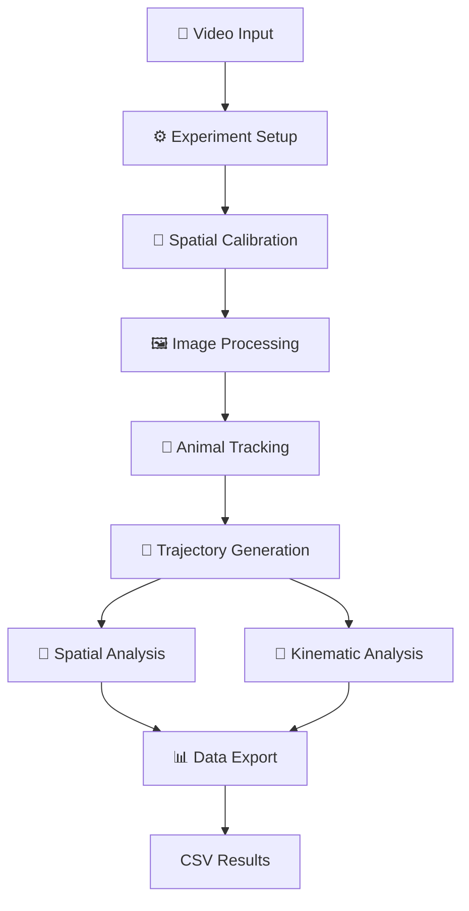

<div align="center">

# 🐾 TrackerLab

### Animal Tracking & Behavioral Analysis

**Turning animal movement into meaningful data.**

A computer vision application designed to track animal movement in video recordings, reconstruct trajectories, and extract spatial and kinematic measurements.

<br>

<!-- Badges: replace or add repository-specific badges (build status, release, etc.) -->


<br>

[Features](#-key-features) •
[How It Works](#-how-it-works) •
[Installation](#-installation) •
[Usage](#-usage) •
[Roadmap](#-roadmap) •
[Documentation](#-documentation)

</div>

---

## 🔬 About the Project

TrackerLab is a computer vision project focused on automated animal tracking and movement analysis from video recordings.

The application processes video frames, detects a target animal using configurable visual tracking strategies, and converts its movement into structured experimental data.

Its purpose is to provide a practical foundation for analyzing animal trajectories and spatial behavior while establishing a framework for future improvements in accuracy, usability, and computational efficiency.

> **Project vision:** Build an intuitive and extensible tool that connects computer vision with quantitative animal behavior analysis.

---

## ✨ Key Features

### 🎯 Multiple Tracking Strategies

TrackerLab currently integrates three approaches to target tracking:

- **Background Subtraction** — Detects foreground objects by comparing video frames against a background model.
- **Silhouette Tracking** — Identifies the subject using image segmentation and shape-related characteristics.
- **Color-Based Tracking** — Uses HSV color segmentation to isolate a target with distinctive visual features.

Each method offers different advantages depending on the subject, background, and recording conditions.

### 📐 Spatial Calibration

Configure the experimental coordinate system using:

- Region of Interest (ROI).
- Experimental zones.
- Pixel-to-centimeter calibration.
- Custom XY coordinate origin.
- Reusable calibration settings.

### 📊 Movement Analysis

Extract quantitative information from the tracked trajectory, including:

- Position and displacement.
- Total traveled distance.
- Velocity and acceleration.
- Movement direction and angular changes.
- Time spent in experimental zones.
- Zone entries and first-entry latency.
- Distance to zone centers and boundaries.

### 💾 Structured Data Export

Export tracking data to CSV files for further analysis, visualization, and statistical processing.

The output includes frame-level observations and aggregated experimental measurements.

### ⚙️ Configurable Processing

Adapt the tracking process to the recording conditions through configurable detection parameters and tracking frequency.

### 🔄 Tracking Recovery

The application handles frames in which the subject cannot be detected, avoiding the direct interpretation of missing observations as real movement.

---

## 🧠 How It Works

TrackerLab follows a processing pipeline that transforms a video recording into quantitative movement data.



### Processing Stages

| Stage | Description |
|-------|-------------|
| **Video Input** | Loads the recording and obtains its frame properties. |
| **Experiment Setup** | Defines the tracking configuration and analysis parameters. |
| **Calibration** | Establishes the ROI, experimental zones, spatial scale, and coordinate origin. |
| **Image Processing** | Applies image transformations and segmentation. |
| **Animal Tracking** | Detects the target using the selected tracking strategy. |
| **Trajectory Generation** | Converts valid detections into spatial coordinates over time. |
| **Data Analysis** | Calculates movement metrics and zone-related measurements. |
| **Data Export** | Saves frame-level observations and summary results. |

---

## 🛠️ Built With

| Technology | Purpose |
|------------|---------|
| **Python** | Core programming language |
| **OpenCV** | Video processing, image segmentation, and visual tracking |
| **NumPy** | Numerical computations and array operations |
| **Tkinter** | Desktop interface and configuration dialogs |
| **CSV** | Structured data export |
| **JSON** | Configuration and calibration persistence |

---

## 🚀 Installation

### Prerequisites

Before running TrackerLab, make sure you have:

- Python installed.
- Git installed.
- Access to the project repository.
- A video recording suitable for animal tracking.

> **Note:** The Python version and dependency versions should be confirmed against the project's tested environment.

### 1. Clone the Repository

```bash
git clone <REPOSITORY_URL>
cd TrackerLab
```

Replace `<REPOSITORY_URL>` with the actual URL of your GitHub repository.

### 2. Create a Virtual Environment

**macOS / Linux**

```bash
python3 -m venv .venv
source .venv/bin/activate
```

**Windows**

```bash
python -m venv .venv
.venv\Scripts\activate
```

### 3. Install Dependencies

If the repository contains a `requirements.txt` file:

```bash
pip install -r requirements.txt
```

Otherwise, install the dependencies required by the current script:

```bash
pip install opencv-python numpy
```

> Tkinter is included with many standard Python installations, although some Linux distributions require installing it separately.

### 4. Run TrackerLab

Use the actual entry-point filename present in the repository. For example:

```bash
python TrackerLab_2026_FINAL_COLOR_MODE_FPS.py
```

If the main script has been renamed, replace the filename accordingly.

---

## 📖 Usage

The general workflow consists of the following steps:

1. Select a video to analyze.
2. Configure the experiment and the tracking parameters.
3. Define the Region of Interest (ROI) to restrict the analysis.
4. Configure experimental zones if spatial behavior is being evaluated.
5. Calibrate the spatial scale and coordinate origin.
6. Select a tracking strategy according to the recording conditions.
7. Review the detection and adjust the parameters if necessary.
8. Run the tracking process and monitor the trajectory.
9. Export the results for subsequent analysis.

> **Tip:** For reliable results, use recordings with adequate contrast, stable lighting, and minimal visual interference whenever possible.

---

## 📁 Project Structure

The current implementation is organized primarily around a Python script that integrates the graphical interface, video processing, tracking, calibration, and data export.

As the project evolves, the following modular structure is a potential direction for development:

```text
TrackerLab/
│
├── ui/
│   ├── launcher.py
│   ├── dialogs.py
│   └── calibration_views.py
│
├── video/
│   └── reader.py
│
├── tracking/
│   ├── background_subtraction.py
│   ├── silhouette.py
│   └── color_tracking.py
│
├── calibration/
│   ├── spatial.py
│   └── zones.py
│
├── analysis/
│   ├── trajectory.py
│   ├── kinematics.py
│   └── spatial_metrics.py
│
├── persistence/
│   ├── configuration.py
│   └── results.py
│
├── resources/
│
├── tests/
│
├── main.py
├── requirements.txt
└── README.md
```

> **Important:** This structure illustrates a proposed modular architecture. It does not necessarily represent the current repository layout.

---

## 📈 Roadmap

TrackerLab is an evolving project. Potential development priorities include:

- [x] Integrate multiple tracking strategies.
- [x] Implement spatial calibration and experimental zones.
- [x] Calculate trajectory and movement metrics.
- [x] Export structured CSV results.
- [ ] Improve automatic tracking validation.
- [ ] Simplify the calibration workflow.
- [ ] Expand automated testing.
- [ ] Refactor the application into modular components.
- [ ] Improve experiment reproducibility and metadata management.
- [ ] Explore multi-animal tracking.
- [ ] Evaluate advanced computer vision and machine learning methods.

*The checklist reflects the intended project direction and should be updated as features are verified and implemented.*

---

## 📚 Documentation

The project documentation covers the current implementation and its potential evolution.

Topics include:

- System architecture and processing pipeline.
- Configuration and spatial calibration.
- Image processing and segmentation.
- Tracking strategies.
- Trajectory reconstruction.
- Spatial and kinematic metrics.
- Tracking-loss handling.
- Data export and result organization.
- Limitations and optimization opportunities.

The technical report and supplementary materials will be linked here as they become available.

---

## ⚠️ Limitations

Tracking quality depends on the recording conditions, calibration accuracy, and the selected detection strategy.

Potential sources of error include:

- Lighting changes and shadows.
- Background interference.
- Partial occlusion of the subject.
- Incorrect segmentation parameters.
- Temporary tracking loss.
- Errors in spatial calibration.

> TrackerLab should be validated under the conditions of each experiment before its measurements are used for scientific interpretation.

---

## 🎓 Project Context

TrackerLab is being developed as a software engineering and computer vision project focused on animal movement analysis.

Its long-term goal is to provide a maintainable and extensible foundation for experimental tracking, quantitative analysis, and future research-oriented features.

---

## 📄 License

No license has been specified yet.

A license should be added before the project is distributed for reuse, modification, or redistribution. Until then, do not assume that the repository is open source or that others have permission to reuse its code.

---

<div align="center">

### 🐾 TrackerLab

**Observe. Track. Analyze.**

*Turning movement into measurable insight.*

</div>
